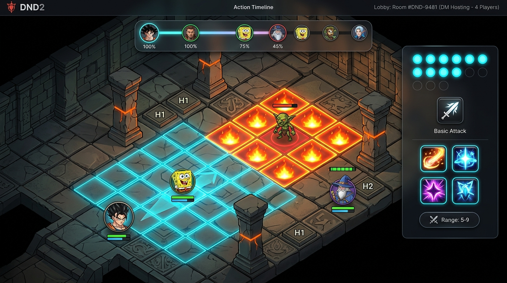
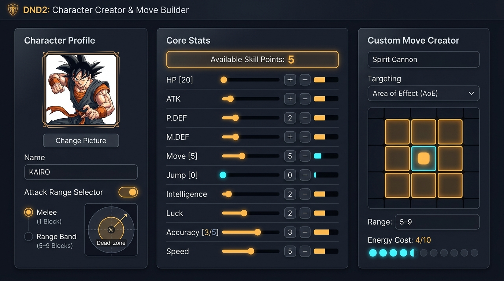
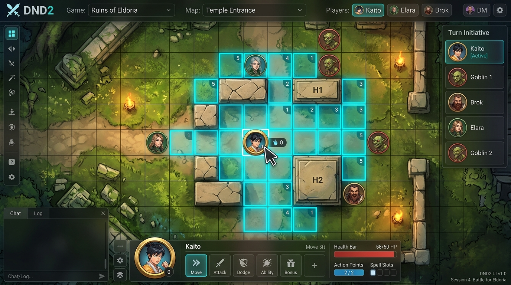

# DND2 — Multiverse Tabletop RPG

DND2 is a multiverse tabletop RPG with strategic, turn-based grid combat. Characters from any fictional universe, or original creations, adventure together under one consistent rule system. Roleplay and exploration happen over voice chat. When a fight starts, the DND2 website handles turns, movement, attacks, defence and tracking.

## What's in this repo

| Path | Contents |
| --- | --- |
| [`RULES_SUMMARY.md`](RULES_SUMMARY.md) | **The complete ruleset**: stats, progression, dice, combat, defence, movement, energy, equipment, the 5 battlefield layouts and the website spec. |
| [`prototype/`](prototype/index.html) | A **playable single-page UI prototype** with the tactical grid, click-to-move pathfinding, the 5 battlefield layouts, breakable walls, traps, high-ground range, a 3x3 AoE preview, and boss pillar cover. |
| [`prototype/assets/maps/`](prototype/assets/maps) | Top-down battlemap art (plains, mountain, dungeon, forest, boss arena). |
| [`docs/concepts/`](docs/concepts) | UI concept art for the full website. |
| [`src/game/types.ts`](src/game/types.ts) | Data model for the full website's rules engine (work in progress). |

## Try the prototype

Open `prototype/index.html` in any browser; no install needed.

To host it online, enable **GitHub Pages** (Settings → Pages → *Deploy from branch* → `main` / root). It will then be at
`https://gokarot2011.github.io/DND2/prototype/`.

In the prototype you can:
- Click your token (**GK**) to highlight every tile you can reach, then click a highlighted tile to move there. The movement cost accounts for walls, height and Jump.
- Switch between the 5 layouts: **Plains**, **Mountainous**, **Dungeon**, **Small Dungeon (6x6)** and **Boss Room (8x8)**.
- Click 🧱 walls to break them, step onto spires for bonus range, and toggle the boss's unblockable blast to see which tiles behind the pillars are safe.

## Status

| Part | Status |
| --- | --- |
| Ruleset design | ✅ Complete (see `RULES_SUMMARY.md`) |
| UI prototype (single-player demo) | ✅ Playable |
| Full website: multiplayer lobby, character creator, DM enemy builder, full combat engine | 🚧 Not built yet; `src/game/types.ts` is the starting point |

**Planned stack:** React + TypeScript + Tailwind CSS, with a DM-hosted lobby that players join by room code, and local-first saves with JSON import/export.

## Concept art

| Tactical combat | Character creator | Click-to-move |
| --- | --- | --- |
|  |  |  |
